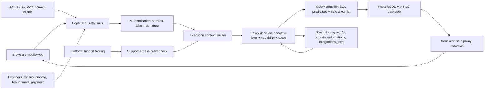

# 1. Security model, invariants, and trust boundaries

## 1.1 Invariants

The 18 invariants are defined in [policy/policy.json](policy/policy.json) and rendered in [generated/principals-roles.md](generated/principals-roles.md#invariants). Threats cite them as mitigations. In summary:

| ID | Invariant (short form) |
|---|---|
| I-01 | Deny by default; errors and missing context deny |
| I-02 | One workspace tenant context per request, except explicit privileged platform operations |
| I-03 | Tenant isolation first; it can never be granted, shared, elevated, or overridden |
| I-04 | No access inferred from IDs, URLs, relationships, mentions, notifications, indexes, projections, or ownership labels |
| I-05 | Relationships never grant access; containment carries only scope grants, never share grants |
| I-06 | The all-brands view aggregates authorized records and owns nothing |
| I-07 | Hidden things are omitted entirely; not-found equals not-authorized |
| I-08 | Authorization applies before counts, sorts, pagination, calculations, recommendations, AI, exports, notifications, webhooks |
| I-09 | Client checks are presentation only; never trust client-supplied workspace, brand, role, plan, approval, or actor fields |
| I-10 | Ownership is responsibility, not access |
| I-11 | No grant, share, delegation, or configuration beyond the actor's own grantable authority |
| I-12 | Revocation takes effect on the next check everywhere; sent external content cannot be recalled and is recorded as such |
| I-13 | Entitlements only remove capabilities |
| I-14 | Execution layers never exceed the delegating principal and their explicit scope; access only shrinks during execution |
| I-15 | Only authorized humans approve, accept, verify, or decide |
| I-16 | Secrets are never readable after storage or present in any output |
| I-17 | Material permission changes, elevations, support access, and denied high-risk attempts are audited immutably |
| I-18 | Field restrictions propagate to every derived output |

## 1.2 Trust boundaries

| Boundary | What crosses it | Controls |
|---|---|---|
| Internet → edge | Untrusted requests and payloads | TLS, rate limiting and abuse protection (SEC-009), request size limits |
| Edge → authentication | Credentials: session cookies, bearer tokens, webhook signatures | Session validation against the server-side store on every request. Tokens are verified by hash, expiry, revocation, and scopes. Webhook signatures and timestamps are checked, plus replay dedupe. |
| Authentication → context | An authenticated principal | Membership resolution in **one** workspace (from the URL or the token's bound workspace, never from a body field), role, teams, epochs, delegation chain ([02](02-principals-and-execution-identity.md)) |
| Context → decision | Principal plus requested action and target | The effective-permission algorithm ([04](04-effective-permissions.md)) and the matrix ([05](05-permission-matrix.md)) |
| Decision → database | Compiled SQL | Predicates applied before `LIMIT`/aggregation. RLS `workspace_id` backstop ([12](12-rls-and-application-policy.md)). |
| Database → client | Rows | Field allow-list serialization, secret redaction, not-found uniformity ([07](07-field-secret-derived-data.md)) |
| Product → AI providers | Context and prompts | Context assembled only through the decision point, with redaction and workspace privacy settings ([09](09-execution-delegation.md)) |
| Product → external systems | Webhooks, sync writes, agent effects | Delivery-time authorization, the external-effect ledger, the approval class, and a field allow-list per destination |
| Platform staff → tenant | Support actions | No access without a customer support grant or audited break-glass. No impersonation. ([02 §2.5](02-principals-and-execution-identity.md#25-support-access-and-impersonation)) |

## 1.3 Likely failure modes and how the design prevents them

| Failure mode | Prevention |
|---|---|
| A new endpoint forgets authorization | All data access goes through module query APIs that require an execution context. The query compiler refuses to compile without a visibility predicate. RLS limits the blast radius to one workspace. A route inventory test (1A) fails on handlers without a declared action. |
| Post-filtering lists breaks counts and leaks totals | Visibility is a SQL predicate. Application-side filtering of collections is prohibited. |
| A projection (search, metrics, activity) becomes a second authorization source | Projections store scope keys only. Authorization is applied at query time ([08](08-search-reporting-notifications-caches.md)). |
| A cached decision outlives a revocation | Context caches are keyed by permission epochs that bump transactionally with every change. Caching decisions in shared projections is forbidden ([13 §13.5](13-permission-changes-and-revocation.md#135-permission-epochs-and-cache-invalidation)). |
| A job runs as "system" with broad access | Jobs carry the effective principal. System jobs hold only their job kind's allow-listed capabilities ([09 §9.7](09-execution-delegation.md#97-background-jobs)). |
| Confused deputy via an agent, automation, or token | Execution scope = intersection with the delegating human. Configuration requires grantable authority over everything granted ([09](09-execution-delegation.md)). |
| An error or timing difference reveals existence | A uniform not-found shape, a timing envelope, and generic validation messages ([06 §6.8](06-guests-sharing-public-links.md#68-permission-safe-not-found)). |
| Field leakage through derived data | Field policy applies to every serializer, filter compiler, formula, conflict response, and AI context builder ([07](07-field-secret-derived-data.md)). |
| Pooled connection carries the wrong tenant | `SET LOCAL` only, fail-closed policy on a missing setting, and leakage tests ([12](12-rls-and-application-policy.md)). |
| An administrator silently reads sensitive data | Sensitive brands and restricted projects remove implicit access. Elevation is owner-only, step-up, reasoned, notified, and audited ([04 §4.4](04-effective-permissions.md#44-restrictions-and-sensitive-scopes)). |
