<!-- GENERATED by docs/architecture/data/tools/datamodel.py render from model/model.json. Do not edit by hand. -->

# Entity-relationship diagrams

One diagram per module. `||--o{` is containment (parent owns children), `||--||` is a 1:1 extension, `}o..o{`/`}o..||` is a non-owning association (dotted). Entities from other modules appear where referenced.

## Execution platform

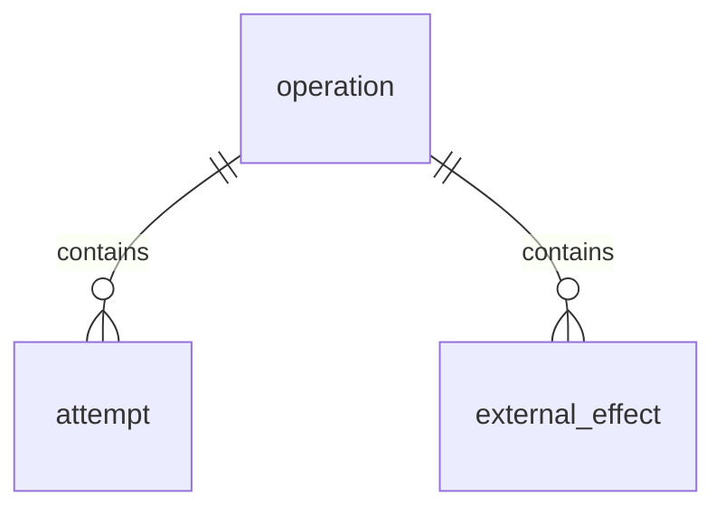

## Record envelope and lifecycle

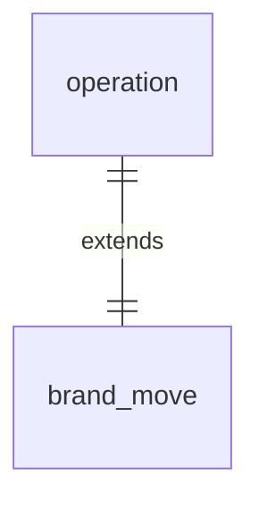

## Identity and accounts

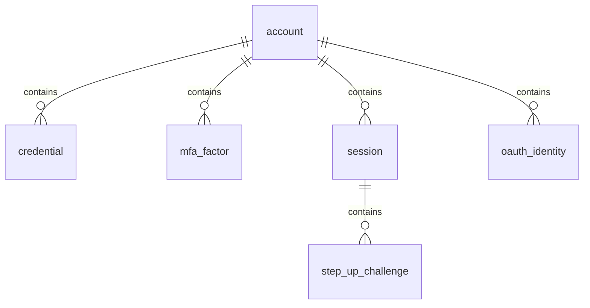

## Workspaces and brands

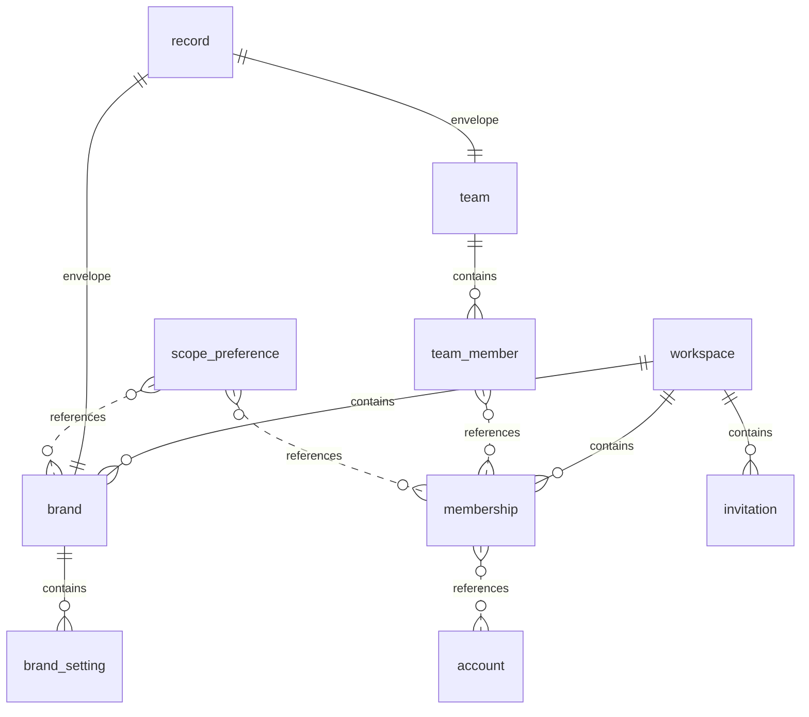

## Grants and policy storage

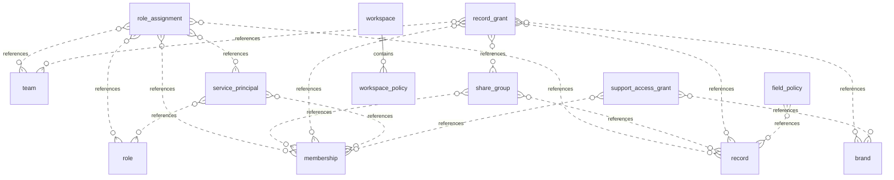

## Usage metering and limits

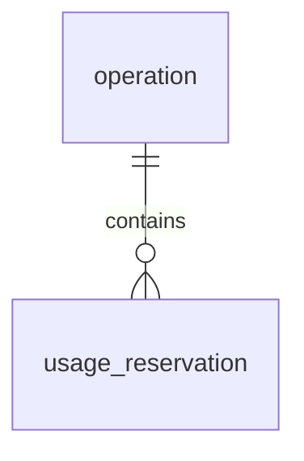

## Billing and entitlements

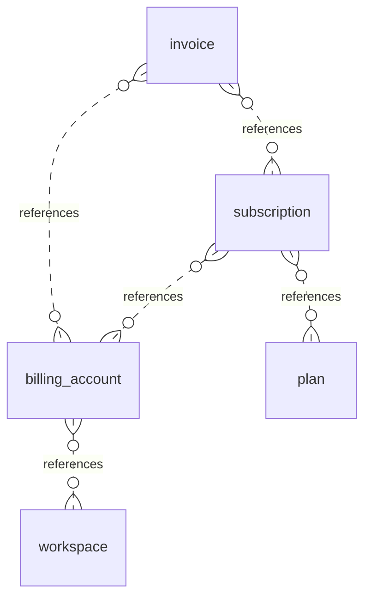

## Workflows and custom fields

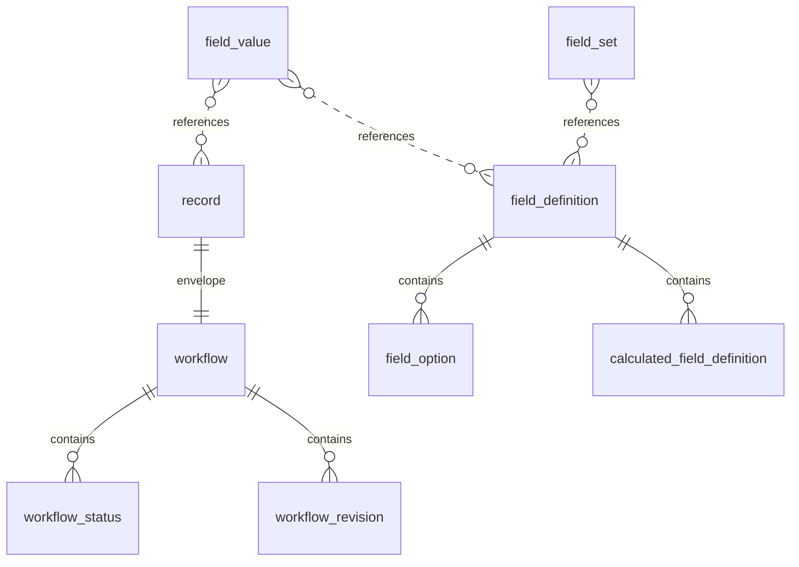

## Relationship primitives

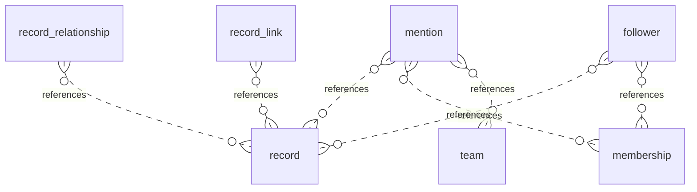

## Files, deliverables, and evidence

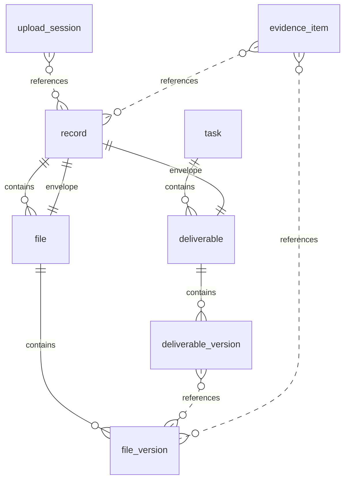

## Comments and reviews

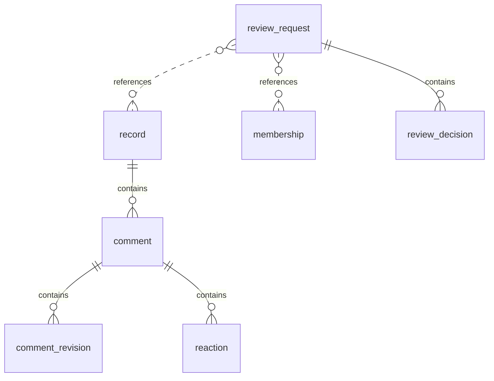

## Notifications

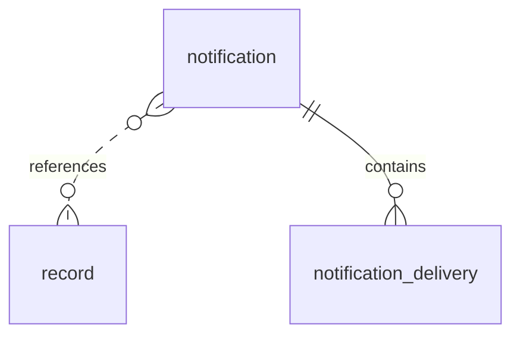

## Projects and tasks

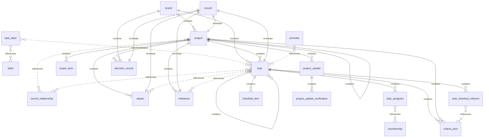

## Inbox and capture

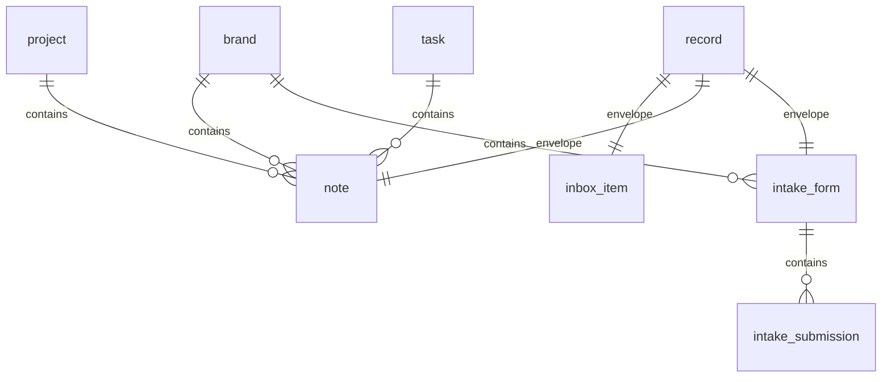

## Today, scheduling, and capacity

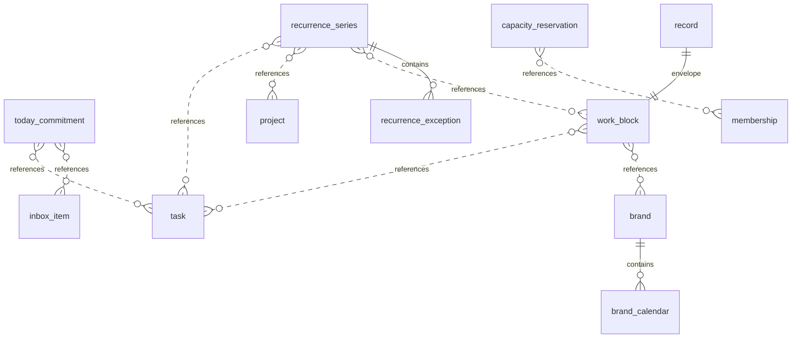

## Time tracking

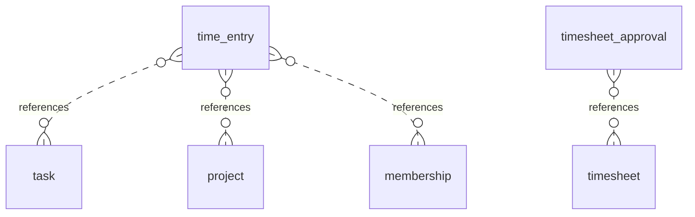

## Documents and knowledge

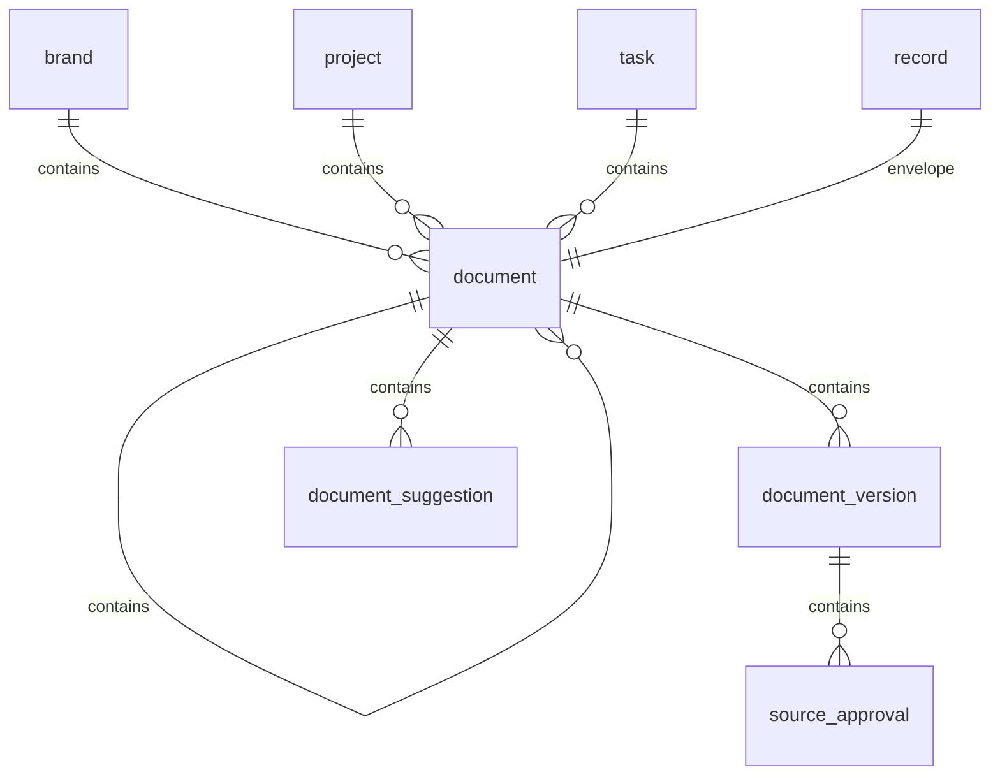

## Goals and portfolios

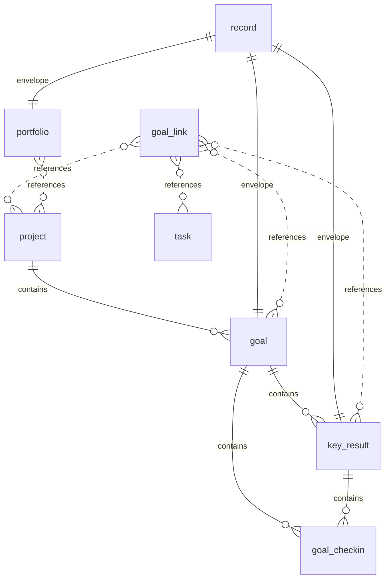

## Views and navigation state

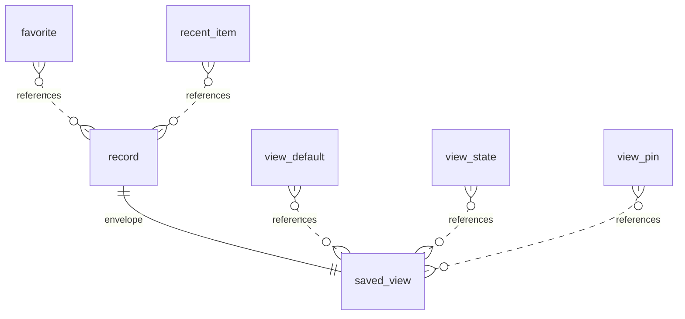

## Search

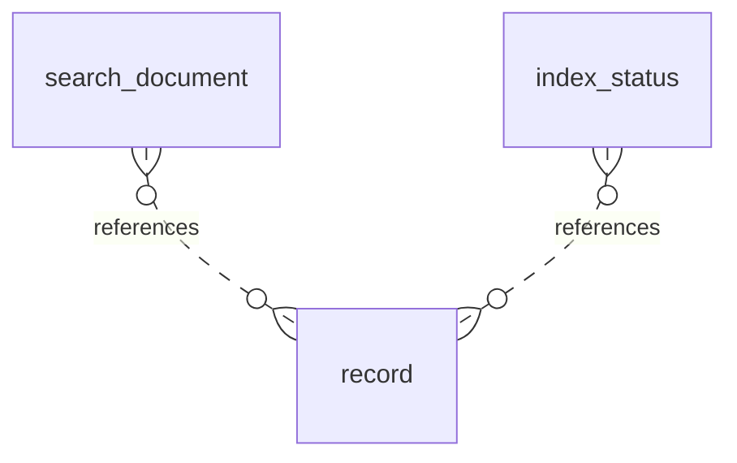

## Metrics, dashboards, and reports

```mermaid
erDiagram
  record ||--|| dashboard : "envelope"
  record ||--|| report_definition : "envelope"
  operation ||--|| report_run : "extends"
```

## Integrations, API, and webhooks

```mermaid
erDiagram
  record ||--|| connection : "envelope"
  connection ||--o{ calendar_event : "contains"
  calendar_event }o..o{ work_block : "references"
  connection_mapping }o..o{ connection : "references"
  connection_mapping }o..o{ brand : "references"
  connection ||--o{ external_identity : "contains"
  external_identity }o..o{ record : "references"
  operation ||--|| sync_run : "extends"
  connection ||--o{ sync_checkpoint : "contains"
  sync_conflict }o..o{ external_identity : "references"
  sync_conflict }o..o{ record : "references"
  record ||--|| webhook_subscription : "envelope"
  webhook_subscription ||--o{ webhook_delivery : "contains"
  api_token }o..o{ service_principal : "references"
  api_token }o..o{ membership : "references"
```

## Import and export

```mermaid
erDiagram
  operation ||--|| import_job : "extends"
  import_job ||--o{ import_row : "contains"
  operation ||--|| export_job : "extends"
  export_job ||--o{ export_file : "contains"
```

## Test management and defects

```mermaid
erDiagram
  brand ||--o{ test_case : "contains"
  project ||--o{ test_case : "contains"
  record ||--|| test_case : "envelope"
  test_case ||--o{ test_case_version : "contains"
  brand ||--o{ test_suite : "contains"
  project ||--o{ test_suite : "contains"
  test_suite }o..o{ test_case : "references"
  record ||--|| test_suite : "envelope"
  test_run }o..o{ environment : "references"
  test_run }o..o{ release : "references"
  test_run }o..o{ test_suite : "references"
  record ||--|| test_run : "envelope"
  test_run ||--o{ test_result : "contains"
  test_result }o..o{ test_case_version : "references"
  test_case ||--o{ flaky_classification : "contains"
  task ||--o{ defect_detail : "contains"
  defect_detail }o..o{ test_result : "references"
  defect_detail }o..o{ environment : "references"
  task ||--o{ verification_record : "contains"
  verification_record }o..o{ test_result : "references"
  verification_record }o..o{ environment : "references"
```

## Development links and releases

```mermaid
erDiagram
  dev_link }o..o{ task : "references"
  dev_link }o..o{ external_identity : "references"
  external_fact }o..o{ external_identity : "references"
  brand ||--o{ environment : "contains"
  record ||--|| environment : "envelope"
  environment ||--o{ deployment : "contains"
  deployment }o..o{ release : "references"
  brand ||--o{ release : "contains"
  release }o..o{ project : "references"
  release }o..o{ milestone : "references"
  record ||--|| release : "envelope"
  release ||--o{ release_scope_item : "contains"
  release_scope_item }o..o{ record : "references"
  release ||--o{ release_checklist_item : "contains"
  release ||--o{ blocker_waiver : "contains"
  release ||--o{ release_decision : "contains"
```

## Templates and onboarding

```mermaid
erDiagram
  record ||--|| template : "envelope"
  template ||--o{ template_version : "contains"
  operation ||--|| template_installation : "extends"
```

## AI actions and briefings

```mermaid
erDiagram
  brand ||--o{ brand_ai_profile : "contains"
  operation ||--|| ai_action : "extends"
  ai_action ||--o{ ai_context_ref : "contains"
  ai_context_ref }o..o{ record : "references"
  ai_action ||--o{ ai_output : "contains"
  ai_action ||--o{ change_proposal : "contains"
  change_proposal ||--o{ proposed_change : "contains"
  proposed_change }o..o{ record : "references"
  operation ||--|| briefing : "extends"
  briefing ||--o{ briefing_statement : "contains"
  briefing_statement }o..o{ record : "references"
```

## Automations

```mermaid
erDiagram
  record ||--|| automation : "envelope"
  automation ||--o{ automation_version : "contains"
  operation ||--|| automation_run : "extends"
  automation_run }o..o{ automation_version : "references"
  automation_run ||--o{ automation_step_run : "contains"
```

## Agents and execution control

```mermaid
erDiagram
  record ||--|| agent_profile : "envelope"
  agent_profile ||--o{ agent_scope_grant : "contains"
  agent_scope_grant }o..o{ brand : "references"
  agent_scope_grant }o..o{ project : "references"
  agent_scope_grant }o..o{ connection : "references"
  agent_profile ||--o{ agent_tool_grant : "contains"
  agent_profile ||--o{ agent_connector : "contains"
  task ||--o{ agent_assignment : "contains"
  agent_assignment }o..o{ agent_profile : "references"
  operation ||--|| agent_run : "extends"
  agent_run }o..o{ task : "references"
  agent_run }o..o{ agent_profile : "references"
  agent_run ||--o{ agent_tool_call : "contains"
  agent_tool_call }o..o{ external_effect : "references"
  agent_run ||--o{ artifact : "contains"
  artifact }o..o{ file_version : "references"
  agent_run ||--o{ action_approval : "contains"
  action_approval }o..o{ review_request : "references"
```

## Support and feedback

```mermaid
erDiagram
  support_request ||--o{ diagnostics_bundle : "contains"
```
