<!-- GENERATED by docs/architecture/data/tools/datamodel.py render from model/model.json. Do not edit by hand. -->

# Module index

Narrative and rules: [../01-module-map.md](../01-module-map.md).

```mermaid
flowchart BT
  execution["Execution platform (L0)"]
  audit["Audit and activity (L0)"]
  core["Record envelope and lifecycle (L0)"]
  identity["Identity and accounts (L1)"]
  tenancy["Workspaces and brands (L1)"]
  access["Grants and policy storage (L1)"]
  governance["Retention and governance (L1)"]
  metering["Usage metering and limits (L1)"]
  billing["Billing and entitlements (L1)"]
  workflow["Workflows and custom fields (L2)"]
  relations["Relationship primitives (L2)"]
  files["Files, deliverables, and evidence (L3)"]
  collab["Comments and reviews (L2)"]
  notify["Notifications (L2)"]
  work["Projects and tasks (L3)"]
  capture["Inbox and capture (L3)"]
  planning["Today, scheduling, and capacity (L3)"]
  time["Time tracking (L3)"]
  knowledge["Documents and knowledge (L3)"]
  goals["Goals and portfolios (L3)"]
  views["Views and navigation state (L3)"]
  search["Search (L4)"]
  insights["Metrics, dashboards, and reports (L4)"]
  integrations["Integrations, API, and webhooks (L4)"]
  transfer["Import and export (L4)"]
  quality["Test management and defects (L4)"]
  delivery["Development links and releases (L4)"]
  templates["Templates and onboarding (L4)"]
  ai["AI actions and briefings (L5)"]
  automation["Automations (L5)"]
  agents["Agents and execution control (L5)"]
  support["Support and feedback (L4)"]
  metrics["Metrics ledger (L4)"]
  audit --> execution
  core --> execution
  core --> audit
  identity --> execution
  identity --> audit
  tenancy --> identity
  tenancy --> core
  tenancy --> execution
  tenancy --> audit
  access --> tenancy
  access --> core
  access --> audit
  access --> execution
  governance --> tenancy
  governance --> core
  governance --> audit
  governance --> execution
  metering --> tenancy
  metering --> execution
  metering --> audit
  billing --> tenancy
  billing --> metering
  billing --> execution
  billing --> audit
  workflow --> tenancy
  workflow --> core
  workflow --> audit
  workflow --> execution
  relations --> core
  relations --> tenancy
  relations --> audit
  relations --> execution
  files --> core
  files --> tenancy
  files --> work
  files --> collab
  files --> metering
  files --> audit
  files --> execution
  collab --> core
  collab --> tenancy
  collab --> audit
  collab --> execution
  notify --> core
  notify --> tenancy
  notify --> execution
  notify --> audit
  work --> core
  work --> tenancy
  work --> workflow
  work --> relations
  work --> collab
  work --> audit
  work --> execution
  capture --> core
  capture --> tenancy
  capture --> work
  capture --> files
  capture --> audit
  capture --> execution
  planning --> core
  planning --> tenancy
  planning --> work
  planning --> capture
  planning --> audit
  planning --> execution
  time --> core
  time --> tenancy
  time --> work
  time --> audit
  time --> execution
  knowledge --> core
  knowledge --> tenancy
  knowledge --> work
  knowledge --> files
  knowledge --> audit
  knowledge --> execution
  goals --> core
  goals --> tenancy
  goals --> work
  goals --> audit
  goals --> execution
  views --> core
  views --> tenancy
  views --> audit
  views --> execution
  search --> core
  search --> tenancy
  search --> execution
  insights --> core
  insights --> tenancy
  insights --> views
  insights --> execution
  insights --> audit
  integrations --> core
  integrations --> tenancy
  integrations --> access
  integrations --> metering
  integrations --> planning
  integrations --> execution
  integrations --> audit
  transfer --> core
  transfer --> tenancy
  transfer --> files
  transfer --> execution
  transfer --> audit
  quality --> core
  quality --> tenancy
  quality --> work
  quality --> files
  quality --> integrations
  quality --> delivery
  quality --> execution
  quality --> audit
  delivery --> core
  delivery --> tenancy
  delivery --> work
  delivery --> integrations
  delivery --> execution
  delivery --> audit
  templates --> core
  templates --> tenancy
  templates --> execution
  templates --> audit
  templates --> work
  ai --> core
  ai --> tenancy
  ai --> metering
  ai --> execution
  ai --> audit
  automation --> core
  automation --> tenancy
  automation --> metering
  automation --> execution
  automation --> audit
  agents --> core
  agents --> tenancy
  agents --> access
  agents --> work
  agents --> collab
  agents --> files
  agents --> metering
  agents --> integrations
  agents --> execution
  agents --> audit
  support --> identity
  support --> tenancy
  support --> files
  support --> execution
  support --> audit
  metrics --> core
  metrics --> tenancy
  metrics --> work
  metrics --> execution
```

| Module | Layer | Schema | Responsibilities | Depends on | Publishes | FEATURES sections | Entities |
|---|---|---|---|---|---|---|---|
| **Execution platform** (`execution`) | 0 | `exec` | Logical operations and attempts, idempotency keys, durable job queue, transactional outbox and consumer inbox, external-effect ledger. | — | `operation.*`, `job.*` | REL | 7 |
| **Audit and activity** (`audit`) | 0 | `audit` | Append-only audit events, explicit redactions, security events, user-facing activity projection. | execution | `audit.redacted` | AUD, SEC | 4 |
| **Record envelope and lifecycle** (`core`) | 0 | `core` | Identity, public ID, scope, and lifecycle envelope for addressable records; archive cascades; deletion batches; tombstones; purge orchestration. | execution, audit | `record.archived`, `record.restored`, `record.trashed`, `record.purged`, `record.moved_brand` | — | 4 |
| **Identity and accounts** (`identity`) | 1 | `identity` | Accounts, credentials, MFA factors, sessions, OAuth identities, verification and recovery tokens. | execution, audit | `account.created`, `account.deleted`, `session.revoked` | A11Y, SEC | 8 |
| **Workspaces and brands** (`tenancy`) | 1 | `tenancy` | Workspaces, brands and brand settings, memberships, teams, invitations, ownership transfer. | identity, core, execution, audit | `workspace.*`, `brand.*`, `membership.*` | A11Y, ADM, COL, WSB | 9 |
| **Grants and policy storage** (`access`) | 1 | `access` | Role definitions and assignments, explicit record grants (shares), workspace sharing and feature policies. Evaluation semantics are owned by Phase 0C. | tenancy, core, audit, execution | `grant.created`, `grant.revoked`, `role.assigned` | ADM, PERM | 9 |
| **Retention and governance** (`governance`) | 1 | `governance` | Retention policy references, legal holds, deletion requests for accounts and workspaces. | tenancy, core, audit, execution | `retention.policy_changed`, `workspace.deletion_requested` | ADM, SEC | 3 |
| **Usage metering and limits** (`metering`) | 1 | `metering` | Usage events, period balances, spend limits, usage reservations for hard caps. | tenancy, execution, audit | `usage.threshold_reached`, `usage.limit_reached` | AI, BILL | 4 |
| **Billing and entitlements** (`billing`) | 1 | `billing` | Billing accounts, subscriptions, plans, entitlements, invoices, payment events, coupons. Billing records outlive workspaces. | tenancy, metering, execution, audit | `subscription.*`, `entitlement.changed` | BILL | 7 |
| **Workflows and custom fields** (`workflow`) | 2 | `workflow` | Workflows, statuses mapped to fixed categories, transitions and rules with revisions, custom field definitions, field sets, typed values, calculated fields. | tenancy, core, audit, execution | `workflow.revised`, `field.values_changed` | WFL | 15 |
| **Relationship primitives** (`relations`) | 2 | `relations` | Typed record relationships (dependency, related), mentions and record links, followers. | core, tenancy, audit, execution | `relationship.*`, `mention.created`, `follow.*` | TSK | 4 |
| **Files, deliverables, and evidence** (`files`) | 3 | `files` | Stored objects, files and versions, attachments, external links, deliverables and versions, evidence items, storage usage. | core, tenancy, work, collab, metering, audit, execution | `file.scanned`, `deliverable.version_submitted` | FILE | 8 |
| **Comments and reviews** (`collab`) | 2 | `collab` | Comments, threads, revisions, reactions, review requests with named reviewers, immutable per-reviewer decisions, and the append-only assignment history behind delegation and reassignment. | core, tenancy, audit, execution | `comment.*`, `review.requested`, `review.decided`, `review.withdrawn`, `review.superseded` | COL, TSK | 7 |
| **Notifications** (`notify`) | 2 | `notify` | Notifications, delivery attempts per channel, preferences, mutes, quiet hours, digests. | core, tenancy, execution, audit | `notification.delivered` | COL, NTF | 6 |
| **Projects and tasks** (`work`) | 3 | `work` | Projects (trees), phases, milestones, tasks (trees), assignees, checklists, criteria items, labels, project updates, decisions, reminders. | core, tenancy, workflow, relations, collab, audit, execution | `project.*`, `task.*`, `task.completed` | PRJ, TSK | 16 |
| **Inbox and capture** (`capture`) | 3 | `capture` | Personal Inbox items, notes, intake forms and submissions, email capture addresses, triage outcomes. | core, tenancy, work, files, audit, execution | `inbox.captured`, `inbox.triaged` | CAP | 7 |
| **Today, scheduling, and capacity** (`planning`) | 3 | `planning` | Today commitments, daily records, work blocks, recurrence series, availability, holidays, time off, capacity reservations. | core, tenancy, work, capture, audit, execution | `commitment.*`, `work_block.*`, `occurrence.generated` | CAL, PLAN, TIME | 14 |
| **Time tracking** (`time`) | 3 | `timetrack` | Time entries and timers, timesheets, per-brand approvals, period locks. | core, tenancy, work, audit, execution | `time_entry.*`, `timesheet.*` | TIME, TSK | 6 |
| **Documents and knowledge** (`knowledge`) | 3 | `knowledge` | Documents and page trees, immutable versions, approved-source verifications, suggestions. | core, tenancy, work, files, audit, execution | `document.*`, `document.source_approved` | DOC | 8 |
| **Goals and portfolios** (`goals`) | 3 | `goals` | Goals, key results, goal links, check-ins, derived recalculation state, portfolios, and portfolio members. | core, tenancy, work, audit, execution | `goal.*` | GOAL | 7 |
| **Views and navigation state** (`views`) | 3 | `views` | Saved views and query definitions, defaults, pins, favorites, recently viewed, persisted view state. | core, tenancy, audit, execution | `view.*` | A11Y, NAV, VIEW | 6 |
| **Search** (`search`) | 4 | `search` | Permission-filtered search projection fed by events, indexing status and failures, recent searches. | core, tenancy, execution | `search.index_failed` | SRCH | 3 |
| **Metrics, dashboards, and reports** (`insights`) | 4 | `insights` | Versioned metric definitions, metric snapshots, dashboards, widgets, reports, schedules, report runs. | core, tenancy, views, execution, audit | `report.delivered` | GOAL, RPT | 7 |
| **Integrations, API, and webhooks** (`integrations`) | 4 | `integrations` | Connections, resource mappings, external identities, external calendar-event mirrors, sync runs, checkpoints and conflicts, inbound endpoints and messages, outbound webhook subscriptions and deliveries, API tokens, OAuth/MCP clients. | core, tenancy, access, metering, planning, execution, audit | `connection.*`, `sync.*`, `webhook.delivery_failed` | CAL, DEV, INT | 19 |
| **Import and export** (`transfer`) | 4 | `transfer` | Import jobs, saved mappings, row outcomes and rollback, export jobs and expiring export files. | core, tenancy, files, execution, audit | `import.*`, `export.*` | DATA | 6 |
| **Test management and defects** (`quality`) | 4 | `quality` | Test cases and immutable versions, suites, runs, results, flaky classification, defect details, verification records. | core, tenancy, work, files, integrations, delivery, execution, audit | `test_result.recorded`, `defect.verified` | TEST | 8 |
| **Development links and releases** (`delivery`) | 4 | `delivery` | Development links, external code facts, environments, deployments, releases, scope, checklist, blocker waivers, immutable release decisions. | core, tenancy, work, integrations, execution, audit | `release.decided`, `deployment.recorded` | DEV, TEST | 9 |
| **Templates and onboarding** (`templates`) | 4 | `templates` | Templates and immutable template versions, installations and provenance, sample data, onboarding progress. | core, tenancy, execution, audit, work | `template.installed` | ONB | 4 |
| **AI actions and briefings** (`ai`) | 5 | `ai` | Provider configurations, brand AI profiles, AI actions, context references, outputs, change proposals, briefings and statements, corrections. | core, tenancy, metering, execution, audit | `ai_action.*`, `proposal.applied`, `briefing.generated` | AI, BRF | 17 |
| **Automations** (`automation`) | 5 | `automation` | Automation definitions with immutable versions, runs and step runs. | core, tenancy, metering, execution, audit | `automation_run.*` | AUTO | 4 |
| **Agents and execution control** (`agents`) | 5 | `agents` | Agent profiles, scope and tool grants, connectors, assignments, runs, tool calls, artifacts, action approvals, emergency stop. | core, tenancy, access, work, collab, files, metering, integrations, execution, audit | `agent_run.*`, `action_approval.*` | AGT | 10 |
| **Support and feedback** (`support`) | 4 | `support` | Support requests, consented diagnostics bundles, feedback, platform content (help, changelog, roadmap, status). | identity, tenancy, files, execution, audit | `support.request_created` | SUP | 4 |
| **Metrics ledger** (`metrics`) | 4 | `metrics` | Append-only task status history and the reconciliation state that proves and repairs it; the figures themselves are computed from records at request time (ADR-38). | core, tenancy, work, execution |  | RPT | 2 |
